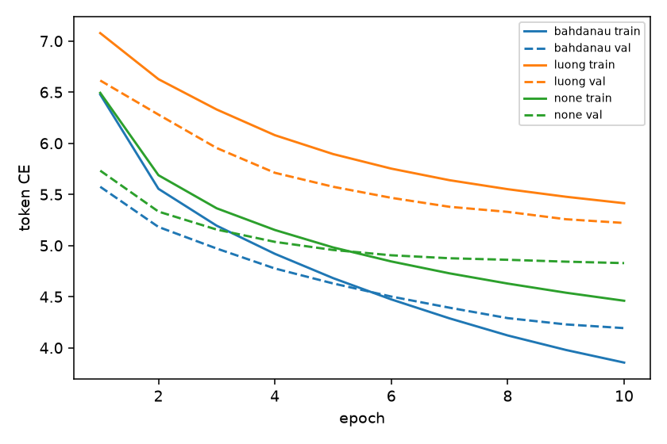
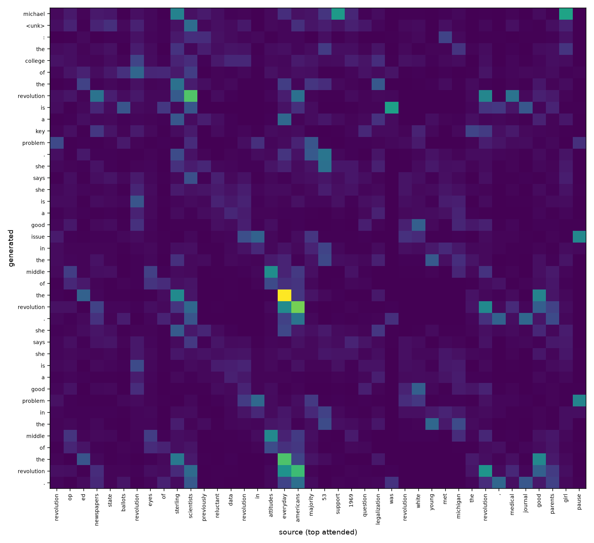

# PrecisAI: Extractive & Neural Abstractive Text Summarization

[](https://www.python.org/downloads/release/python-3110/)
[](https://pytorch.org/)
[](https://streamlit.io/)
[](https://opensource.org/licenses/MIT)

**PrecisAI** is an end-to-end text summarization system implemented from scratch in PyTorch. It bridges classical unsupervised extractive summarization with deep neural sequence-to-sequence abstractive modeling, and evaluates zero-shot transfer under domain shift on real-world Indian government circulars and press releases.

---

## Key Highlights

- **From-Scratch Deep Sequence-to-Sequence Modeling**:
  - **Bidirectional GRU Encoder** & single-layer **GRUCell Decoder**.
  - **Attention Mechanisms Implemented & Compared**:
    - **Bahdanau** (Additive attention; context fed directly into GRU decoder recurrent state).
    - **Luong** (General/multiplicative attention; context projected post-GRU).
    - **None** (Vanilla sequence-to-sequence baseline).
  - Mixed Precision Training (Automatic Mixed Precision / AMP) with linear warm-up and early stopping.
- **Unsupervised Extractive Summarization**:
  - Graph-based **TextRank** using TF-IDF sentence representation, cosine similarity graph construction, and PageRank scoring.
- **Quality Tuning & Inference Optimization**:
  - **Attention-Guided `<unk>` Replacement**: Dynamically resolves out-of-vocabulary tokens by aligning with top-attended source tokens, driving `<unk>` rate from **4.4% down to 0.00%**.
  - **$N$-gram Blocking ($N=3$)**: Eliminates repetitive looping in greedy decoding, reducing trigram repetition from **91.6% down to 3.8%**.
  - **Tuned Beam Search** (Beam 4): length-normalized ($\alpha=1.0$) with min-length constraint ($\ge 20$), achieving **30.61 ROUGE-1 / 8.86 ROUGE-2 / 20.40 ROUGE-L**. Best-per-metric with Beam 6 (same settings): 9.17 ROUGE-2 / 20.41 ROUGE-L.
- **Extended Syllabus Comparison (same CLIs, same tables)**:
  - **Decoding**: top-k and nucleus sampling with temperature (mean ± std over seeds) next to greedy and beam search.
  - **Metrics**: test perplexity, BLEU-4, distinct-1/2 and an unsupported-number rate (hallucination proxy), also computed on the government documents.
  - **Embeddings**: Word2Vec (CBOW and Skip-Gram) trained on the 40k training articles; TextRank over averaged Word2Vec vectors (`--repr w2v`).
  - **Pretrained transformers (inference only)**: `t5-small` and BERT-embedding TextRank (`bert-extractive`) selectable in `evaluate` and `gov_eval`.
  - **Studies**: TextRank preprocessing ablation, tokenizer comparison (word-level, WordPiece, BPE, SentencePiece), a from-scratch self-attention demo, a neural extractive summariser and a blinded human-evaluation sheet.
- **Real-World Government Benchmark**:
  - Zero-shot transfer (domain shift) evaluation on official press releases and regulatory instruments from the **Press Information Bureau (PIB)**, Ministry of Electronics & IT (MeitY), Ministry of Mines, Ministry of Road Transport and Highways (MoRTH), Ministry of Education, and MoEFCC.
  - Sentence-aware document chunking (`--chunking`) to evaluate documents exceeding the model's 400-token context window.
  - **Policy Preservation Lexical Audit (`factual_audit`)**: Automated heuristic verification checking retention of statutory schemes, percentages, dates, currencies, and regulatory entities.
- **Interactive Dual-Mode Web Application (`app.py`)**:
  - Streamlit dashboard offering CNN/DailyMail evaluation alongside real-world Government circular summarization.
  - Interactive **Attention Heatmap Visualization** displaying token-to-token alignment.
  - Real-time compression metrics, token counts, and policy preservation audits.

---

## Architecture Overview

```
                               +-----------------------------+
                               |        Source Document      |
                               +--------------+--------------+
                                              |
        +-------------------+-----------------+-----------------+-------------------+
        |                   |                                   |                   |
        v                   v                                   v                   v
[ Extractive Pipeline ] [ Embedding-based Extractive ]  [ Abstractive Pipeline ] [ Pretrained Transformer ]
  Sentence Splitting      Sentence Splitting              Word Tokenization        (inference only)
        |                   |                                   |                   |
  TF-IDF / BoW vectors    Averaged Word2Vec (--repr w2v)   Vocab (30,000 words)   t5-small
  (stop-words, stemming,  or mean-pooled BERT              BiGRU Encoder (2x256-d) "summarize: " prefix
   lemmas, n-grams)       (--repr bert / bert-extractive)  Attention Mechanism     Beam 4 decoding
        |                   |                              (Bahdanau / Luong / None)  |
  Cosine Similarity Graph   Cosine Similarity Graph        GRU Decoder (512-d)      |
        |                   |                              Decoding: greedy, beam,   |
  PageRank Centrality       PageRank Centrality            top-k, nucleus,          |
        |                   |                              trigram block, UNK replace |
        v                   v                                   v                   v
   Top-3 Sentences     Top-3 Sentences                    Generated Summary     Generated Summary
        \_________________________________________  _____________________________/
                                                  \/
                       Unified evaluation: ROUGE, BLEU-4, distinct-n, perplexity,
                       unsupported-number rate  (src.evaluate, src.gov_eval)
```

### Mathematical Formulation of Attention

1. **Bahdanau Additive Attention**:
   $$e_{t,i} = v_a^\top \tanh\left(W_a s_{t-1} + U_a h_i\right)$$
   $$\alpha_{t,i} = \frac{\exp(e_{t,i})}{\sum_{j} \exp(e_{t,j})}, \quad c_t = \sum_i \alpha_{t,i} h_i$$
   The context vector $c_t$ is concatenated with the target embedding $[y_{t-1}; c_t]$ and fed into the GRUCell.

2. **Luong General Attention**:
   $$e_{t,i} = s_t^\top W_a h_i$$
   $$\tilde{s}_t = \tanh\left(W_c [c_t; s_t]\right)$$
   $$\hat{y}_t = \operatorname{softmax}\left(W_s \tilde{s}_t\right)$$

3. **GNMT Length Penalty & Coverage Penalty**:
   $$\text{Score}(Y, X) = \frac{\log P(Y|X)}{((5 + |Y|) / 6)^\alpha} - \beta \sum_{i=1}^{|X|} \max\left(0, \sum_{t=1}^{|Y|} \alpha_{t,i} - 1.0\right)$$

---

## Experimental Results

Evaluated on the **CNN/DailyMail 3.0.0** test subset ($n=500$ articles, single seed). ROUGE F1 scores are calculated using official stemmed `rouge-score` against full reference highlights.

### 1. Model Comparison Baseline

| Model | ROUGE-1 | ROUGE-2 | ROUGE-L | Avg Len | `<unk>` Rate | Tri-Repeat Rate |
|---|:---:|:---:|:---:|:---:|:---:|:---:|
| **TextRank** (Extractive) | **35.80** | **14.10** | **23.38** | 76.0 | 0.0000 | 0.664 |
| **Seq2Seq-Bahdanau (Beam 4)** | 28.65 | 7.93 | 19.30 | 44.5 | 0.0408 | **0.000** |
| **Seq2Seq-Bahdanau (Greedy)** | 25.18 | 5.75 | 18.12 | 49.5 | 0.0440 | 0.916 |
| **Seq2Seq-None (Beam 4)** | 19.37 | 3.41 | 13.81 | 34.3 | 0.0584 | **0.000** |
| **Seq2Seq-None (Greedy)** | 17.76 | 2.59 | 13.62 | 42.5 | 0.0805 | 0.950 |
| **Seq2Seq-Luong (Beam 4)** | 16.49 | 2.44 | 12.07 | 30.7 | 0.0925 | **0.000** |
| **Seq2Seq-Luong (Greedy)** | 14.02 | 1.57 | 11.83 | 39.3 | 0.1161 | 0.962 |

### 2. Quality Tuning & Decoding Optimization (Bahdanau Model)

| Strategy | ROUGE-1 | ROUGE-2 | ROUGE-L | Avg Len | `<unk>` Rate | Tri-Repeat | Notes |
|---|:---:|:---:|:---:|:---:|:---:|:---:|---|
| Baseline Greedy | 25.18 | 5.75 | 18.12 | 49.5 | 4.40% | 91.6% | Repetitive loops; entities dropped |
| + Trigram Blocking ($N=3$) | 27.28 | 6.39 | 18.44 | 48.7 | 4.48% | **0.0%** | Repetition eliminated |
| + Attention UNK Replacement | 26.80 | 6.46 | 18.99 | 49.5 | **0.00%** | 89.0% | `<unk>` replaced with top attended tokens |
| **Combined Tuned Greedy** | **28.99** | **7.12** | **19.38** | 48.7 | **0.00%** | **3.8%** | **+3.81 R1, +1.37 R2 over baseline greedy** |
| Baseline Beam 4 ($\alpha=0.6$) | 28.65 | 7.93 | 19.30 | 44.5 | 4.08% | 0.0% | Default beam search |
| **Tuned Beam 4 ($\alpha=1.0, \text{min}=20$)** | **30.61** | **8.86** | **20.40** | 45.7 | **0.00%** | 2.6% | **Highest ROUGE-1 (+1.96 pts)** |
| **Tuned Beam 6 ($\alpha=1.0, \text{min}=20$)** | **30.55** | **9.17** | **20.41** | 44.7 | **0.00%** | 1.6% | **Highest ROUGE-2 (9.17) & ROUGE-L (20.41)** |

### 3. Visualizations

| Training & Validation Loss Curves | Attention Alignment Heatmap |
|:---:|:---:|
|  |  |

### 4. Extended Comparison

One command produces the unified table (see Quickstart 7). Rows are appended to `results/metrics.md`; per-model rows are also saved to `results/partial/` as each model finishes. Unsupported-number rate is the share of numeric tokens in a summary that never occur in its source: a lexical hallucination proxy that ignores number words and cannot detect misused but present numbers.

| model | R-1 | R-2 | R-L | avg len | unk rate | tri-repeat | BLEU-4 | distinct-1 | distinct-2 | unsupported-number rate | test ppl |
|---|---|---|---|---|---|---|---|---|---|---|---|
| textrank | 35.8 | 14.1 | 23.38 | 76.0 | 0.0 | 0.664 | 10.29 | 0.263 | 0.717 | 0.0 | - |
| textrank-w2v | 31.27 | 10.06 | 18.96 | 96.1 | 0.0 | 0.34 | 6.56 | 0.253 | 0.733 | 0.0 | - |
| textrank-bert | 32.84 | 11.24 | 20.13 | 91.5 | 0.0 | 0.384 | 7.39 | 0.256 | 0.74 | 0.0 | - |
| seq2seq-bahdanau-greedy | 25.18 | 5.75 | 18.12 | 49.5 | 0.044 | 0.916 | 4.04 | 0.099 | 0.352 | 0.1895 | 72.03 |
| seq2seq-bahdanau-beam4 | 28.65 | 7.93 | 19.3 | 44.5 | 0.0408 | 0.0 | 5.14 | 0.121 | 0.453 | 0.1484 | 72.03 |
| seq2seq-luong-greedy | 14.02 | 1.57 | 11.83 | 39.3 | 0.1161 | 0.962 | 0.81 | 0.013 | 0.048 | 0.7956 | 188.78 |
| seq2seq-luong-beam4 | 16.49 | 2.44 | 12.07 | 30.7 | 0.0925 | 0.0 | 0.87 | 0.022 | 0.08 | 0.7429 | 188.78 |
| seq2seq-none-greedy | 17.76 | 2.59 | 13.62 | 42.5 | 0.0805 | 0.95 | 1.4 | 0.062 | 0.18 | 0.7667 | 129.49 |
| seq2seq-none-beam4 | 19.37 | 3.41 | 13.81 | 34.3 | 0.0584 | 0.0 | 1.44 | 0.083 | 0.245 | 0.7575 | 129.49 |
| t5-small-beam4 | 37.29 | 16.54 | 26.51 | 45.1 | 0.0 | 0.17 | 11.33 | 0.239 | 0.715 | 0.0065 | - |
| bert-extractive | 32.84 | 11.24 | 20.13 | 91.5 | 0.0 | 0.384 | 7.39 | 0.256 | 0.74 | 0.0 | - |

Source: `results/metrics.md` ("Extended comparison", first section). `bert-extractive` and `textrank-bert` are the same method (BERT-embedding TextRank) reached through `--models` and `--repr`. `t5-small` is the public pretrained checkpoint, inference only; its pretraining mixture includes CNN/DailyMail summarisation, so it is not a clean zero-shot result. Test perplexity is per target token and applies to the checkpoint, so greedy and beam rows share it.

Sampling decoders (Bahdanau, mean ± std over seeds):

| model | R-1 | R-2 | R-L | avg len | unk rate | tri-repeat | BLEU-4 | distinct-1 | distinct-2 | unsupported-number rate | test ppl |
|---|---|---|---|---|---|---|---|---|---|---|---|
| seq2seq-bahdanau-topk-T1.0 | 24.35 ± 0.24 | 3.61 ± 0.17 | 15.18 ± 0.21 | 53.23 ± 0.12 | 0.04 ± 0.00 | 0.26 ± 0.02 | 2.35 ± 0.09 | 0.13 ± 0.00 | 0.56 ± 0.00 | 0.45 ± 0.02 | 72.03 |
| seq2seq-bahdanau-nucleus-T1.0 | 22.61 ± 0.05 | 3.10 ± 0.06 | 14.18 ± 0.05 | 53.83 ± 0.29 | 0.03 ± 0.00 | 0.18 ± 0.02 | 2.28 ± 0.13 | 0.17 ± 0.00 | 0.66 ± 0.00 | 0.53 ± 0.00 | 72.03 |
| seq2seq-bahdanau-topk-T0.7 | 25.82 ± 0.22 | 4.91 ± 0.20 | 16.87 ± 0.19 | 51.07 ± 0.34 | 0.04 ± 0.00 | 0.50 ± 0.01 | 3.44 ± 0.20 | 0.12 ± 0.00 | 0.49 ± 0.00 | 0.36 ± 0.02 | 72.03 |
| seq2seq-bahdanau-nucleus-T0.7 | 26.40 ± 0.08 | 5.28 ± 0.08 | 17.30 ± 0.07 | 51.03 ± 0.29 | 0.04 ± 0.00 | 0.55 ± 0.01 | 3.67 ± 0.02 | 0.12 ± 0.00 | 0.48 ± 0.00 | 0.32 ± 0.01 | 72.03 |

TextRank preprocessing ablation (`python -m src.text_study`, `results/text_study.md`):

- weighting: bow=33.19, tfidf=34.31
- stop-words removed: False=32.39, True=35.10
- normalisation: none=33.78, porter=33.75, lemma=33.72
- n-grams: (1, 1)=33.83, (1, 2)=33.67

Default configuration (TF-IDF, stop-words removed, no normalisation, unigrams) in this grid: 35.8 / 14.1 / 23.38 (R-1 / R-2 / R-L). Full 24-row grid in `results/text_study.md`.

Tokenizer study (`python -m src.tokenizer_study`, `results/tokenizers.md`):

| tokenizer | CNN/DM OOV/unk rate | CNN/DM avg tokens/article | CNN/DM % > 400 | gov OOV/unk rate | gov avg tokens/doc | gov % > 400 |
|---|---|---|---|---|---|---|
| word-level (30k, project) | 2.44% | 812 | 84.8% | 9.53% | 2204 | 66.7% |
| BERT WordPiece (bert-base-uncased) | 0.00% | 867 | 88.6% | 0.00% | 2481 | 66.7% |
| GPT-2 BPE | 0.00% | 860 | 88.0% | 0.00% | 2559 | 66.7% |
| T5 SentencePiece (t5-small) | 0.00% | 971 | 91.2% | 0.00% | 2706 | 66.7% |

Example segmentations of rare government-document words are in `results/tokenizers.md`.

Word2Vec (`python -m src.embeddings`, `results/word2vec.md`, `results/word2vec_plots.png`):

Mean top-10 neighbour overlap with the seq2seq embedding: cbow = 0.02, skipgram = 0.01 (over 10 words).

✓ = correct top-1, ~ = correct in top-5, ✗ = miss. Accuracy top-1 / top-5: cbow 5/8 , 6/8; skipgram 6/8 , 8/8; seq2seq-enc-emb 0/8 , 0/8.


Neighbour lists for 10 words and the analogy table are in `results/word2vec.md`. The seq2seq encoder embedding shows almost no semantic structure, which is expected for an embedding trained only through a summarisation loss.

Neural extractive summariser (`python -m src.neural_extractive`, `results/neural_extractive.md`):

| system | selection F1 | R-1 | R-2 | R-L |
|---|---|---|---|---|
| Lead-3 | 34.73 | 40.23 | 17.31 | 24.78 |
| Oracle (top-3 by label) | 100.00 | 49.39 | 27.23 | 34.49 |
| SummaRuNNer-lite, GRU sentence encoder | 41.42 ± 0.14 | 38.66 ± 0.12 | 16.60 ± 0.06 | 24.62 ± 0.15 |
| SummaRuNNer-lite, LSTM sentence encoder | 41.80 ± 1.09 | 38.82 ± 0.41 | 16.75 ± 0.38 | 24.81 ± 0.23 |

Mean ± std over 3 seeds; labels are top-3 sentences by ROUGE-1+ROUGE-2 F (own n-gram implementation) against the reference. Details in `results/neural_extractive.md`.

---

## Government Circulars & Regulatory Benchmark

The model is trained only on CNN/DailyMail and never fine-tuned on government text, so this is zero-shot transfer under domain shift. To test it outside the news domain, PrecisAI includes a benchmark of official Indian Government releases collected from the Press Information Bureau (PIB) across 9 ministries (Renewable Energy, Mines, MeitY, Education, Highways, MSDE, Cooperation, Housing, MoEFCC).

| Model | Evaluated Docs | Avg Summary Tokens | Avg Compression Ratio |
|---|:---:|:---:|:---:|
| **TextRank** | 9 | 57.44 | 6.41x |
| **BiGRU-GRU (Bahdanau Greedy)** | 9 | 52.78 | 7.09x |
| **BiGRU-GRU (Bahdanau Beam 4)** | 9 | 46.44 | 8.35x |
| **BiGRU-GRU (Luong Beam 4)** | 9 | 35.89 | 10.26x |
| **BiGRU-GRU (None Beam 4)** | 9 | 46.67 | 8.01x |

**How to read these numbers:** the 9 documents have no reference summaries, so no ROUGE is computed. Compression ratio and the keyword audit are descriptive checks, not quality scores; a higher compression ratio only means shorter output.

Extended comparison (appended to `results/government/metrics.md`; `nan` = the summaries contained no numbers):

| model | summaries | avg summary tokens | avg compression ratio | unsupported-number rate |
|---|---:|---:|---:|---:|
| textrank | 9 | 57.44 | 6.4061 | 0.0 |
| bigru_gru_bahdanau_greedy | 9 | 51.0 | 7.3596 | 0.2 |
| bigru_gru_bahdanau_beam | 9 | 46.44 | 8.3544 | 0.0 |
| bigru_gru_luong_greedy | 9 | 48.89 | 7.741 | nan |
| bigru_gru_luong_beam | 9 | 35.89 | 10.2626 | nan |
| bigru_gru_none_greedy | 9 | 50.44 | 7.2966 | nan |
| bigru_gru_none_beam | 9 | 46.67 | 8.0094 | 0.25 |
| t5-small | 9 | 44.22 | 8.3589 | 0.0 |
| bert-extractive | 9 | 60.0 | 6.0389 | 0.0 |

The pipeline includes:
- **`src.gov_sources`**: Clean text extraction from official PIB releases and metadata manifests.
- **`src.gov_eval`**: Evaluation suite with `--chunking` for long documents.
- **`factual_audit`**: Heuristic verification checking whether critical policy indicators (numbers, schemes, statutory dates, percentages) present in the source text are preserved in the generated summary.

---

## Course Syllabus Coverage

All additions are optional flags or new modules; defaults reproduce the original pipeline exactly. Dialogue systems, reasoning and text-classification topics are out of scope for this project.

| Unit | Topic | Code | Result file | Status |
|---|---|---|---|---|
| I | TF-IDF/BoW, stop-words, stemming, lemmatization, n-grams | `src/textrank.py` (`stop_words`, `norm`, `weighting`, `ngram`), `src/text_study.py` | `results/text_study.md` | done |
| I, V | Tokenization: word-level vs WordPiece vs BPE vs SentencePiece | `src/vocab.py`, `src/tokenizer_study.py` | `results/tokenizers.md` | done |
| II | Word2Vec (CBOW, Skip-Gram), neighbours, analogies, PCA/t-SNE, W2V-TextRank | `src/embeddings.py`, `src/textrank.py` (`--repr w2v`) | `results/word2vec.md`, `results/word2vec_plots.png`, `results/metrics.md` | done |
| III | Neural extractive summarisation (SummaRuNNer-lite, BiGRU vs BiLSTM) | `src/neural_extractive.py` | `results/neural_extractive.md` | done |
| IV | Seq2Seq, attention, decoding (greedy, beam, top-k, nucleus) | `src/model.py`, `src/decode.py`, `src/sampling.py`, `src/evaluate.py` | `results/metrics.md`, `results/tuning.md` | done |
| V | Transformers: self-attention, positional encoding, BERT, pretrained T5 | `src/transformer_demo.py`, `src/pretrained.py` | `results/bert_attention.png`, `results/metrics.md`, `results/government/metrics.md` | done |
| VI | Evaluation: ROUGE, BLEU-4, perplexity, diversity, hallucination proxy, human-eval protocol | `src/evaluate.py`, `src/gov_eval.py`, `src/metrics_extra.py`, `src/human_eval.py` | `results/metrics.md`, `results/human_eval.csv` (ratings blank, to be filled by raters) | done |

---

## Repository Structure

```
├── .gitignore
├── app.py                     # Streamlit dual-mode web dashboard
├── environment.yml            # Conda environment definition
├── requirements.txt           # Pinned pip dependencies
├── HANDOFF.md                 # Project development notes & resume point
├── README.md                  # Project documentation
│
├── src/                       # Core codebase
│   ├── model.py               # BiGRU Encoder, GRU Decoder, Bahdanau & Luong attention
│   ├── vocab.py               # Vocabulary builder with UNK replacement decoder
│   ├── decode.py              # Greedy decoding, tuned beam search, coverage penalties
│   ├── textrank.py            # Cosine graph + PageRank extractive model (TF-IDF default; BoW, stemming, n-grams, W2V, BERT options)
│   ├── preprocess.py          # CNN/DailyMail dataset loader and tensor cache builder
│   ├── train.py               # Mixed-precision training pipeline with early stopping
│   ├── evaluate.py            # ROUGE evaluation & parameter sweep CLI
│   ├── gov_sources.py         # Government document scraper and text cleaner
│   ├── gov_eval.py            # Government benchmark evaluation and policy audit
│   ├── sampling.py            # Top-k / nucleus sampling decoders with temperature
│   ├── metrics_extra.py       # Test perplexity, BLEU-4, distinct-n, unsupported-number rate
│   ├── pretrained.py          # t5-small and BERT-embedding TextRank (inference only)
│   ├── embeddings.py          # Word2Vec training/analysis, sentence-vector factories
│   ├── text_study.py          # TextRank preprocessing ablation
│   ├── tokenizer_study.py     # Word-level vs WordPiece vs BPE vs SentencePiece
│   ├── transformer_demo.py    # From-scratch self-attention + positional encoding, BERT heatmap
│   ├── neural_extractive.py   # SummaRuNNer-lite sentence scorer
│   └── human_eval.py          # Blinded human-evaluation sheet and aggregation
│
├── data/
│   └── circulars/             # Official government documents & benchmark
│       ├── manifest.jsonl     # Provenance and document metadata
│       ├── cleaned/           # Extracted clean UTF-8 document texts
│       ├── samples/           # Sample document extracts
│       └── raw/               # Retrieved official HTML files
│
└── results/                   # Experimental logs and generated metrics
    ├── metrics.json           # Baseline benchmark metrics (JSON)
    ├── metrics.md             # Baseline benchmark table (Markdown)
    ├── tuning.md              # Quality tuning & decoding sweep analysis
    ├── beam_sweep.json        # Hyperparameter grid search logs
    ├── loss_curves.png        # Training/validation loss curves
    ├── attention_heatmap.png  # Decoder-to-encoder attention alignment matrix
    ├── text_study.md          # TextRank preprocessing ablation
    ├── tokenizers.md          # Tokenizer study
    ├── word2vec.md            # Word2Vec neighbours, analogies, comparison
    ├── word2vec_plots.png     # PCA / t-SNE
    ├── bert_attention.png     # BERT self-attention heatmap
    ├── neural_extractive.md   # Neural extractive results
    ├── human_eval.csv         # Blinded rating sheet (ratings blank)
    ├── extended_metrics.json  # Machine-readable extended comparison
    └── government/            # Government document evaluation artifacts
        ├── metrics.md         # Government benchmark summary
        ├── document_metrics.json
        └── summaries.json
```

---

## Quickstart & Installation

### 1. Prerequisites & Environment Setup

```bash
# 1. Clone repository
git clone https://github.com/Auric-Coder/precisAI.git
cd precisAI

# 2. Create conda environment
conda create -n precisai python=3.11 -y
conda activate precisai

# 3. Install PyTorch with CUDA 12.6
pip install torch --index-url https://download.pytorch.org/whl/cu126

# 4. Install pinned project dependencies
pip install -r requirements.txt
```

### 2. Preprocess Data

Processes the CNN/DailyMail 3.0.0 subset (40k train, 2k val, 500 test), trims articles to 400 tokens and targets to 60 tokens, and constructs a 30,000-token vocabulary:

```bash
python -m src.preprocess

# Or run a fast sanity check on a 500/100/50 subset:
python -m src.preprocess --smoke
```

### 3. Model Training

Train the sequence-to-sequence model with automatic mixed precision (AMP) and early stopping:

```bash
# Train with Bahdanau additive attention (recommended)
python -m src.train --attn bahdanau --epochs 10

# Train Luong or vanilla baseline:
python -m src.train --attn luong --epochs 10
python -m src.train --attn none --epochs 10
```

*Checkpoints are saved to `checkpoints/{attn}.pt`.*

### 4. Evaluation & Quality Tuning

Evaluate checkpoints on the 500-article test set:

```bash
# Standard evaluation
python -m src.evaluate

# Tuned evaluation with attention-guided UNK replacement and beam search
python -m src.evaluate --models bahdanau --unk_replace --beam 4 --alpha 1.0 --min_len 20
```

### 5. Government Document Benchmark

Run zero-shot transfer evaluation on the collected government circulars:

```bash
# Extract and update cleaned circular texts from manifest
python -m src.gov_sources

# Run government document evaluation
python -m src.gov_eval

# Run with sentence-aware document chunking
python -m src.gov_eval --chunking
```

### 6. Interactive Web Dashboard

Launch the interactive Streamlit user interface:

```bash
streamlit run app.py
```

The web UI provides:
1. **CNN/DailyMail Mode**: Compare extractive TextRank against trained Seq2Seq models, select decoding methods (greedy vs beam), and render attention heatmaps.
2. **Government Document Mode**: Select an official PIB document from the manifest (or paste your own), inspect token compression ratios, and review real-time policy preservation flags.

### 7. Extended Comparison (one command per flag)

```bash
# Unified table: extractive (TF-IDF, W2V, BERT), BiGRU models and pretrained t5-small, with extra metrics
python -m src.evaluate --models bahdanau luong none t5-small bert-extractive --repr tfidf w2v bert --extra_metrics --no_repeat_ngram 0

# Sampling decoders (mean +- std over --seeds 0 1 2)
python -m src.evaluate --models bahdanau --decode topk --extra_metrics
python -m src.evaluate --models bahdanau --decode nucleus --temperature 0.7 --extra_metrics

# Government documents with the same models and the unsupported-number rate
python -m src.gov_eval --models bahdanau luong none t5-small bert-extractive --extra_metrics

# Studies
python -m src.embeddings          # Word2Vec (trains CBOW/Skip-Gram on first use), neighbours, analogies, plots
python -m src.text_study          # TextRank preprocessing ablation
python -m src.tokenizer_study     # tokenizer comparison
python -m src.transformer_demo    # self-attention shape tests + BERT heatmap
python -m src.neural_extractive   # SummaRuNNer-lite
python -m src.human_eval make     # blinded rating sheet; fill ratings, then:  python -m src.human_eval aggregate
```

Extended runs append to `results/metrics.md` and `results/government/metrics.md`; the original tables are never overwritten.

---

## Limitations

- Single training seed; no variance estimates across runs.
- Evaluation uses 500 CNN/DailyMail test articles.
- The government benchmark has only 9 documents and no reference summaries.
- TextRank outperforms the neural models on ROUGE. This is expected on CNN/DailyMail given its lead bias and the small (40k) training set.
- Luong attention scores below the no-attention baseline. This is unexplained and has not been investigated.

---

## Limitations of Classical Seq2Seq

Numbers below come from existing result files (`results/metrics.md`, `results/tuning.md`, `results/government/document_metrics.json`).

- **Attention is essential.** At beam 4 the Bahdanau model reaches ROUGE-1 28.65 versus 19.37 with no attention (`results/metrics.md`).
- **Degenerate repetition under greedy decoding.** 91.6% of greedy Bahdanau summaries repeat a trigram; n-gram blocking brings this to 0.0% at the cost of a hand-written decoding rule (`results/metrics.md`, `results/tuning.md`).
- **Closed vocabulary.** Greedy and beam summaries contain `<unk>` tokens at a rate of 4.40% and 4.08% of output tokens; attention-based replacement removes them only at decode time (`results/metrics.md`, `results/tuning.md`). The 30k word vocabulary leaves 2.44% of CNN/DM test tokens and 9.53% of government-document tokens out-of-vocabulary; WordPiece, BPE and SentencePiece have none (`results/tokenizers.md`).
- **Hard 400-token input limit.** 6 of the 9 government documents exceed 400 tokens and lose up to 97.1% of their text without `--chunking` (`results/government/document_metrics.json`). 84.8% of CNN/DM test articles exceed 400 word tokens and are truncated (`results/tokenizers.md`).
- **No ground-truth guarantee.** The model can generate content absent from the source; the unsupported-number rate is a proxy only. In beam-4 summaries 14.84% of numbers are absent from the source for Bahdanau, versus 74.29% (Luong) and 75.75% (no attention); TextRank has 0.0% (`results/metrics.md`).

---

## Citation & Acknowledgments

- **CNN/DailyMail Dataset**: Hermann et al. (2015), *Teaching Machines to Read and Comprehend*; See et al. (2017), *Get To The Point: Summarization with Pointer-Generator Networks*.
- **TextRank**: Mihalcea and Tarau (2004), *TextRank: Bringing Order into Texts*.
- **Neural Attention Mechanisms**: Bahdanau et al. (2014); Luong et al. (2015).
- **Word2Vec**: Mikolov et al. (2013), *Efficient Estimation of Word Representations in Vector Space*.
- **BERT**: Devlin et al. (2019), *BERT: Pre-training of Deep Bidirectional Transformers for Language Understanding*.
- **T5**: Raffel et al. (2020), *Exploring the Limits of Transfer Learning with a Unified Text-to-Text Transformer*.
- **Nucleus sampling**: Holtzman et al. (2020), *The Curious Case of Neural Text Degeneration*.
- **Transformer**: Vaswani et al. (2017), *Attention Is All You Need*.
- **Government Sources**: Press Information Bureau (PIB), Government of India public portals.

---

## License

This project is licensed under the [MIT License](LICENSE).
