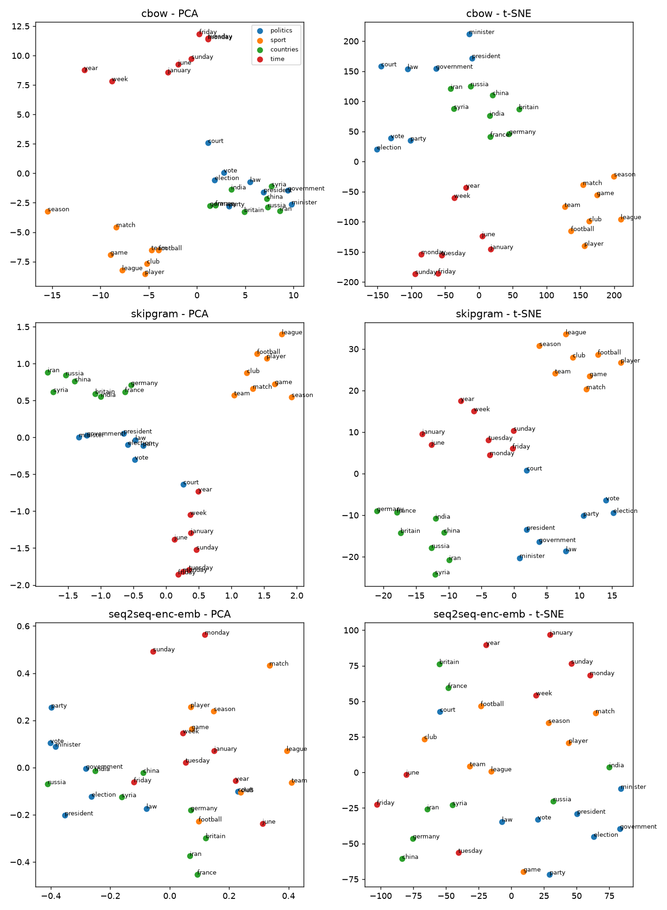

# Word2Vec study (Unit II)

Gensim Word2Vec on the 40k CNN/DM training articles (project tokenizer, lowercased): dim 128, window 5, min_count 5, negative 5, 3 epochs, seed 0, workers=1. Vocab 73218 (CBOW/SG). seq2seq-enc-emb = encoder embedding of checkpoints/bahdanau.pt (256-d, trained only for summarisation, read-only).

## Nearest neighbours (cosine, top 6)

| word | CBOW | Skip-Gram | seq2seq enc. emb |
|---|---|---|---|
| government | coalition, governments, regime, kremlin, eu, israel | coalition, mdc, ntc, houthis, unilaterally, statehood | funky, strike, melatonin, shelters, machar, floodwater |
| president | biden, ahmadinejad, senator, versa, nieto, presidency | barack, maduro, petro, obama, medvedev, biden | khan, 800, adam, prism, cheney, swindled |
| police | detectives, authorities, investigators, nypd, officers, prosecutors | officers, detectives, lapd, authorities, nypd, dyfed | maitland, ecuadorian, ducked, vendors, rugged, raped |
| court | tribunal, judge, jury, courtroom, courts, prosecution | judge, magistrate, sentencing, hearing, magistrates, courtroom | armband, accelerated, holden, clippers, koeman, norfolk |
| market | markets, currency, prices, marketplace, revenues, economy | markets, marketplace, wholesale, prices, cheapest, retail | conned, condos, unlocked, balotelli, nestle, peck |
| election | elections, presidency, vote, presidential, candidate, nomination | elections, midterm, midterms, presidential, reelection, presidency | coates, reform, calum, regrettably, measures, zayed |
| war | conflict, occupation, invasion, dictatorship, disobedience, revolution | conflict, wars, ii, vietnam, battlefields, yugoslavia | lump, grealish, grandeur, civilian, xvi, moderator |
| health | healthcare, floss, education, welfare, agriculture, pathway | occupational, healthcare, institutes, mental, phe, wellbeing | throttle, nestle, airtime, healer, contradicted, virus |
| school | college, schools, classes, teacher, wycombe, church | elementary, college, teacher, kindergarten, schools, teachers | dna, levi, ramirez, checklist, boys, villa |
| football | rugby, soccer, cricket, player, sport, baseball | soccer, rugby, players, player, footballers, leagues | pillows, sever, twitter, coldplay, aesthetics, score |

Mean top-10 neighbour overlap with the seq2seq embedding: cbow = 0.02, skipgram = 0.01 (over 10 words).

## Analogies (a:b::c:?, top-1 / top-5 over the full vocab, honest small-corpus result)

| analogy | cbow | skipgram | seq2seq-enc-emb |
|---|---|---|---|
| man:woman::king:queen | queen ✓ | elizabeth ~ | modified ✗ |
| he:she::his:her | her ✓ | her ✓ | switching ✗ |
| france:paris::england:london | brighton ✗ | london ✓ | involvement ✗ |
| germany:berlin::italy:rome | dublin ✗ | rome ✓ | regulars ✗ |
| good:better::bad:worse | worse ✓ | worse ✓ | malone ✗ |
| monday:tuesday::friday:saturday | thursday ~ | thursday ~ | sloot ✗ |
| china:chinese::france:french | french ✓ | french ✓ | merger ✗ |
| boy:girl::brother:sister | sister ✓ | sister ✓ | sleeping ✗ |

✓ = correct top-1, ~ = correct in top-5, ✗ = miss. Accuracy top-1 / top-5: cbow 5/8 , 6/8; skipgram 6/8 , 8/8; seq2seq-enc-emb 0/8 , 0/8.

## W2V-TextRank (extractive, top-3 sentences, averaged word vectors, cosine graph, PageRank d=0.85; CNN/DM test n=500)

| system | R-1 | R-2 | R-L |
|---|---|---|---|
| W2V-TextRank (Skip-Gram) | 31.27 | 10.06 | 18.96 |
| W2V-TextRank (CBOW) | 30.27 | 9.26 | 18.55 |
| seq2seq-embedding TextRank | 30.24 | 9.61 | 18.55 |
| GloVe-100 TextRank | 30.64 | 9.34 | 18.34 |

Reference TF-IDF TextRank (results/metrics.md): R-1 35.8 / R-2 14.1 / R-L 23.38.
